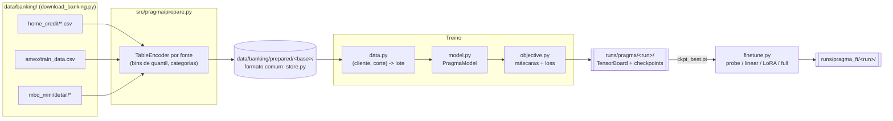

# Sketch: modelo fundacional de eventos bancários (estilo PRAGMA)

Este documento resume como o modelo funciona, que dados ele usa e como vamos conduzir o treino. Cada parte aponta para o arquivo do repositório onde ela acontece. As tasks que queremos atacar estão em [pragma_tasks.md](pragma_tasks.md).

Estado atual: a arquitetura, o preparo dos dados, o pré-treino, o fine-tuning, a busca de hiperparâmetros e o registro no TensorBoard estão implementados. As três bases completas já estão preparadas. O código foi testado com amostras de 2 mil clientes por base e com 120 passos nas bases completas. **Nenhum treino de verdade foi rodado.**

## 1. Visão geral



Uma ideia guia todo o desenho: **nenhum parâmetro depende de uma base**. As colunas são descritas pelo texto do nome, e os valores pelo texto da categoria ou pela posição do bin no CDF. Isso vem do LDM ([src/ldm/](../src/ldm/)). Graças a isso, um único modelo é pré-treinado ao mesmo tempo em Home Credit, AmEx e MBD, apesar dos esquemas diferentes. O PRAGMA não faz isso.

## 2. Dados

### 2.1 Formato comum

Cada base vira um diretório em `data/banking/prepared/<base>/`. O formato está documentado no topo de [store.py](../src/pragma/store.py):

- **Perfil estático** (opcional): uma linha por cliente, codificada pelo `TableEncoder`.
- **Fontes de eventos**: em cada fonte, uma tabela de eventos com as colunas daquela fonte, mais o tempo `t` em dias e o calendário (hora, dia da semana, dia do mês). Os eventos ficam ordenados por cliente e por tempo, com um índice `offsets` por cliente. Os arrays são abertos com mmap, então o treino só lê os eventos do lote.
- **Tabela de rótulos**: linhas `(cliente, corte, y)`. Só entram eventos com `t < corte`. Com isso, uma mesma estrutura serve tanto para "default do cliente" (corte = ∞) quanto para "compra no mês m" (corte = início de m).
- **Split por cliente** (`split.npy`): treino, validação, teste ou sem rótulo.

### 2.2 O que entra de cada base

As bases são preparadas por [prepare.py](../src/pragma/prepare.py), em `prepare_home_credit` ([L87](../src/pragma/prepare.py#L87)), `prepare_amex` ([L155](../src/pragma/prepare.py#L155)) e `prepare_mbd` ([L225](../src/pragma/prepare.py#L225)).

Números das bases completas, já preparadas nesta máquina (9,3 GB em `data/banking/prepared/`). Cada fonte aparece como eventos × colunas.

| Base | Clientes | Perfil | Fontes de eventos | Tempo `t` | Tarefa |
|---|---|---|---|---|---|
| `home_credit` | 356.255 (307.511 com rótulo; 48.744 do teste do Kaggle, sem rótulo) | `application_{train,test}` (120 colunas) | `bureau` 1,7M × 15 · `bureau_balance` 24,2M × 2 · `previous_application` 1,7M × 35 · `pos_cash` 10,0M × 6 · `credit_card` 3,8M × 21 · `installments` 13,6M × 6 | Dias relativos à solicitação (≤ 0). `MONTHS_BALANCE` × 30,44 | `default`: `TARGET`, binária, AUC |
| `amex` | 458.913 (todos com rótulo) | — | `statement` 5,5M × 188 (até 13 extratos por cliente) | Dias relativos ao último extrato (≤ 0) | `default`: `target`, binária, métrica AmEx |
| `mbd_mini` | 100.224 (folds 0–2: 60.147 · fold 3: 20.017 · fold 4: 20.060) | — | `trx` 38,8M × 12 · `geo` 66,3M × 3 · `dialog` 217 mil × 16 | Dias desde 2021-01-01 | `propensity`: 4 produtos por mês, multirrótulo, AUC média |

Decisões de preparo que afetam o modelo:

- **Home Credit:**
  - Os clientes do teste do Kaggle entram sem rótulo. Servem só para o pré-treino.
  - O valor sentinela `365243` nos `DAYS_*` vira nulo.
  - Os IDs (`SK_ID_*`) saem das features.
- **AmEx:**
  - As colunas são renomeadas pelo prefixo, por exemplo `D_39` → "delinquency 39". Sem isso, o encoder de texto não teria nenhuma semântica.
  - As 11 categóricas oficiais são forçadas como `CAT`.
- **MBD:**
  - O embedding de 768 dimensões dos diálogos vira 16 componentes numéricas por PCA (`--dialog-pca`).
  - Os geohashes ficam com as 127 categorias mais frequentes mais `<other>` (`--max-categories`).
  - O rótulo do mês m usa só eventos **antes do primeiro dia de m**. É um corte conservador, que evita vazamento qualquer que seja a definição exata do mês de referência.
- **Splits:**
  - Home Credit e AmEx: 80/10/10 por cliente, com semente 0.
  - MBD: os folds oficiais (0–2 treino, 3 validação, 4 teste).

### 2.3 Do disco ao lote

O carregamento está em [data.py](../src/pragma/data.py):

- `EventDataset.__getitem__` ([L57](../src/pragma/data.py#L57)) lê, de cada fonte, os eventos do cliente anteriores ao corte. Fica só com os `max_events` mais recentes **por fonte**, para que fontes densas (`bureau_balance`, `geo`) não expulsem as outras.
- `collate` ([L74](../src/pragma/data.py#L74)) junta as fontes numa única sequência por cliente, ordenada pelo tempo. Calcula a idade de cada evento até a referência e o intervalo desde o evento anterior. Agrupa as células por fonte, porque cada fonte tem colunas próprias.

## 3. Modelo

Arquivo: [model.py](../src/pragma/model.py). Configuração: `PragmaConfig` ([L37](../src/pragma/model.py#L37)).

```
célula (fonte s, coluna c, valor v)
  valor:   categórica -> TextEmb("texto da categoria")
           numérica   -> MLP(fourier(q_bin), fourier(z_bin)) + MLP(fourier(z_exato))
  + TextEmb(nome da coluna) + E_tipo[num/cat] + TextEmb(nome da fonte)
  (célula mascarada -> e_[MASK])

evento_e  = CellEncoder([EVT] + células do evento)[EVT]        cell_layers blocos
perfil    = CellEncoder'([EVT] + colunas do perfil)[EVT]       profile_layers blocos, pesos próprios
token_e   = evento_e + TextEmb(fonte) + TimeEncoder(idade, Δt, hora, dia da semana, dia do mês)
            (evento mascarado inteiro -> e_[EVENT_MASK] + fonte + tempo)

histórico = Transformer([CLS], perfil, token_1, ..., token_L)     history_layers blocos
cliente   = LN(saída do [CLS])                                    -> embedding para as tarefas
```

| Peça | Onde | O que faz |
|---|---|---|
| `Vocabulary` | [model.py#L57](../src/pragma/model.py#L57) | Embeddings compartilhados por todas as bases: encoder de texto (hash ou MiniLM, reaproveitados de [src/ldm/model.py](../src/ldm/model.py)), opções de valor ([L87](../src/pragma/model.py#L87)) e colunas ([L98](../src/pragma/model.py#L98)) |
| `CellEncoder` | [model.py#L102](../src/pragma/model.py#L102) | Atenção entre as células de um evento. A saída do `[EVT]` é o vetor do evento. É o "per-event encoder" do PRAGMA |
| `TimeEncoder` | [model.py#L129](../src/pragma/model.py#L129) | `log(1+idade)`, `log(1+Δt)` e senoides de calendário, com uma flag de "desconhecido" (no Home Credit não há calendário) |
| `PragmaModel.forward` | [model.py#L181](../src/pragma/model.py#L181) | Encoder de histórico sobre `[CLS]`, perfil e eventos, com máscara de padding. Sem embedding posicional: a ordem vem do tempo |
| `_decode` | [model.py#L239](../src/pragma/model.py#L239) | Autocomplete de células como no LDM: `q = LN(saída_da_célula + W·histórico_no_evento)` e `logit_k = ⟨W_q q, W_out o_ck⟩/√d`. Uma célula mascarada é prevista com o resto do evento mais o histórico. Um evento mascarado inteiro, só com o histórico |
| `ClassifierHead`, `apply_lora` | [model.py#L246](../src/pragma/model.py#L246), [L278](../src/pragma/model.py#L278) | Head das tarefas e adaptadores LoRA nas projeções de atenção (`qkv`, `proj`) |

Com a config padrão (`d_model=256`, 2 + 2 + 6 blocos), o modelo tem **25,2M de parâmetros**, dos quais 16,8M estão na tabela de hash do texto. Num teste de 120 passos nas três bases completas, com lote de 64, ele rodou a cerca de 8 passos/s na RTX A4500 (37 mil eventos/s), com 4,6 GB de pico de memória. O carregamento entrega cerca de 150 lotes/s, então não é gargalo. Os 100 mil passos da config padrão levam cerca de 3h30.

### 3.1 Objetivo de pré-treino

Arquivo: [objective.py](../src/pragma/objective.py). As máscaras são sorteadas em `make_masks` ([L40](../src/pragma/objective.py#L40)) e a perda é calculada em `mlm_loss` ([L71](../src/pragma/objective.py#L71)).

| Máscara | Padrão | O que obriga o modelo a aprender |
|---|---|---|
| Célula (`p_cell`) | 15% | A relação entre os campos de um evento, mais o contexto do histórico |
| Evento (`p_event`) | 10% | A dinâmica do histórico: prever um evento inteiro pelos vizinhos e pelo tempo |
| Tipo (`p_type`) | 10% | Inferir uma variável ausente em todos os eventos, por exemplo todos os `AMT_PAYMENT` do cliente |
| Perfil (`p_profile`) | 15% | A relação entre o perfil e o comportamento (só no Home Credit) |

A perda é a cross-entropy nas células mascaradas, sobre as opções válidas da coluna com `[NULL]` incluído, mais um MSE no valor contínuo das numéricas. Cada tipo de máscara tem média e peso próprios (`w_*`), e cada um aparece separado no TensorBoard.

## 4. Treino

### 4.1 Comandos

```bash
# 0. dados (já feito nesta máquina)
python download_banking.py
python -m src.pragma.prepare home_credit amex mbd_mini     # -> data/banking/prepared/
python -m src.pragma.prepare home_credit amex mbd_mini --max-clients 2000 --suffix _dev   # amostras de teste

# 1. pré-treino
python -m src.pragma.train --config configs/pragma/pretrain.yaml --run-name base_v1
python -m src.pragma.train --config configs/pragma/pretrain.yaml --set optim.lr=1e-3 model.d_model=128
python -m src.pragma.train --resume runs/pragma/base_v1/ckpt_last.pt --run-name base_v1

# 2. busca de hiperparâmetros
python -m src.pragma.sweep configs/pragma/sweep_pretrain.yaml --dry-run
python -m src.pragma.sweep configs/pragma/sweep_pretrain.yaml

# 3. tarefas
python -m src.pragma.finetune --set init=runs/pragma/base_v1/ckpt_best.pt data.dataset=home_credit mode=lora
python -m src.pragma.finetune --set init=null data.dataset=home_credit mode=full      # referência sem pré-treino

# 4. acompanhar
tensorboard --logdir runs
```

### 4.2 Arquivos de configuração

Todas as chaves podem ser sobrescritas com `--set chave.subchave=valor`. O valor é lido como YAML. Quem faz isso é [config.py](../src/pragma/config.py).

| Config | Usada por | Hiperparâmetros principais |
|---|---|---|
| [pretrain.yaml](../configs/pragma/pretrain.yaml) | [train.py](../src/pragma/train.py) | `data.datasets`, `data.temperature`, `data.max_events`, `model.*` (largura, profundidade dos três encoders, `text_encoder`), `mask.*` (taxas e pesos), `optim.*` (lr, warmup, decaimento, lote, passos) |
| [finetune.yaml](../configs/pragma/finetune.yaml) | [finetune.py](../src/pragma/finetune.py) | `init`, `mode` (probe, linear, lora, full), `data.label_frac`, `lora.*`, `head.*`, `optim.lr` e `head_lr`, `pos_weight` |
| [sweep_pretrain.yaml](../configs/pragma/sweep_pretrain.yaml) | [sweep.py](../src/pragma/sweep.py) | Busca aleatória de 12 execuções curtas (20 mil passos): lr, weight decay, largura, profundidade e taxas de máscara |
| [sweep_finetune.yaml](../configs/pragma/sweep_finetune.yaml) | [sweep.py](../src/pragma/sweep.py) | Grade `mode` × `label_frac`: a curva de rótulos |

### 4.3 O que vai para o TensorBoard

Cada execução grava em `runs/pragma/<run>/`: a `config.yaml` resolvida, os eventos do TensorBoard, `metrics.jsonl` (as mesmas métricas em texto), `ckpt_last.pt` (com otimizador, para retomar) e `ckpt_best.pt` (menor `val/loss`).

| Grupo | Chaves | Onde é gerado |
|---|---|---|
| `train/*` | `loss`, `ce_{cell,type,event,profile}`, `acc_*`, `mse`, `grad_norm` | Laço de [train.py](../src/pragma/train.py) |
| `train_<base>/*` | O mesmo, separado por base | Idem |
| `val/loss`, `val_<base>/*` | Perda mascarada em lotes e máscaras fixos de clientes de validação, comparável entre execuções | `validate` ([train.py#L119](../src/pragma/train.py#L119)) |
| `probe_<base>/*` | AUC, PR-AUC, KS, Brier, log-loss (e a métrica AmEx) de uma logística sobre os embeddings congelados | `probe` ([train.py#L148](../src/pragma/train.py#L148)), com métricas de [evaluate.py](../src/pragma/evaluate.py) |
| `opt/*`, `perf/*` | lr, passos/s, eventos/s, memória da GPU | Laço de [train.py](../src/pragma/train.py) |
| HParams | Config achatada × `best_val_loss` e métricas finais do probe | Fim de cada execução |
| Fine-tuning | `train/loss`, `val/<métrica>`, `test/<métrica>` e HParams com `val_*`/`test_*` | [finetune.py](../src/pragma/finetune.py) |

O que observar:

- `val/loss` caindo junto com `train/loss`. Se só a perda de treino cai, é sobreajuste.
- `ce_event` acima de `ce_cell`: prever um evento inteiro é mais difícil.
- `ce_type` abaixo do valor que teria sem contexto.
- **`probe_<base>/auc` subindo ao longo do pré-treino.** É o sinal que importa: mostra que o embedding do cliente captura algo útil para as tarefas.

## 5. Plano de treino

| Fase | O que rodar | Pergunta | Custo estimado |
|---|---|---|---|
| 1. Sanidade | `train.py` com `optim.steps=5000`, uma base de cada vez (`data.datasets=[home_credit]`, ...) | As perdas caem? O probe sai do acaso? | cerca de 15 min por base |
| 2. Busca | `sweep.py configs/pragma/sweep_pretrain.yaml` | Que lr, tamanho e taxas de máscara minimizam `val/loss` e maximizam o probe? | 12 × cerca de 45 min |
| 3. Pré-treino longo | `train.py` com a melhor config, 100 mil passos, nas três bases | — | cerca de 4 h |
| 4. Ablações do pré-treino | (a) uma base por vez vs as três juntas; (b) `p_type=0` e `p_event=0`; (c) `text_encoder=frozen` (MiniLM) vs `hash`; (d) `history_layers` | O pré-treino conjunto ajuda? Que máscara importa? | Uma execução de 20 mil passos por variante |
| 5. Tarefas | `sweep_finetune.yaml` em cada base: `probe`, `lora` e `full` × `label_frac` ∈ {1%, 10%, 100%}, contra `init=null` | Quanto o pré-treino vale com poucos rótulos? LoRA basta? | 9 execuções por base |
| 6. Comparação final | Melhor configuração de cada base no teste, contra os baselines GBDT | O modelo bate agregações feitas à mão + GBDT? | — |

Cuidados que já estão no código:

- **Clientes de avaliação fora do pré-treino.** `data.pretrain_splits: [train, unlabeled]`, então clientes de validação e teste não aparecem no pré-treino.
- **Corte temporal opcional no pré-treino.** `data.time_cutoff: {mbd_mini: <dia>}` limita os eventos do pré-treino a antes de uma data. É o split temporal recomendado no MBD.
- **Validação reprodutível.** Clientes, lotes e máscaras fixos, com semente 12345.
- **Métrica oficial da AmEx.** Os negativos pesam 20, para compensar a subamostragem ([evaluate.py#L32](../src/pragma/evaluate.py#L32)).

## 6. O que ainda falta

- **Baselines GBDT** (LightGBM ou XGBoost com agregações por cliente) para as três tarefas P1. São necessários para a fase 6 e ainda não existem.
- **O MBD completo** (`--mbd-full`) só depois de validar no mini.
- **Objetivos extras de [pragma_tasks.md](pragma_tasks.md)**: contraste entre janelas (CoLES) e próximo evento. Ainda não implementados.
- **Tarefas P2** com rótulos derivados (atraso na próxima parcela, predição antecipada na AmEx). A estrutura de rótulos com corte já comporta essas tarefas: basta gerar as linhas `(cliente, corte, y)`.
